<div align="center">

# torch-hungarian

**Batched linear assignment for PyTorch: the optimal one-to-one matching for thousands of cost matrices at once, with a Triton GPU solver and a SciPy fallback everywhere else.**

[](https://badge.fury.io/py/torch-hungarian) [](https://github.com/Borda/torch-hungarian/actions/workflows/dispatch_gpu-tests.yml) [](https://github.com/Borda/torch-hungarian/actions) [](https://pepy.tech/project/torch-hungarian) [](https://opensource.org/licenses/Apache-2.0)

[Install](#install) · [Quick start](#quick-start) · [How it works](#how-it-works) · [API](#api-reference) · [Backends](#backends-and-support) · [Performance](#performance) · [Integrations](#integrations) · [Development](#development) · [Legacy CUDA](#legacy-cuda-implementation-00x) · [Credits](#credits-and-project-scope) · [Citation](#citation)

</div>

> **Disclaimer: project scope and credit.** `torch-hungarian` is a fork of [torch-linear-assignment](https://github.com/ivan-chai/torch-linear-assignment) kept for practical use: a solver that is fast on supported GPUs, safe on every other device, and stable enough to be wired into third-party packages and projects. It builds on the work of others and does not replace it. The idea, the original compiled CUDA implementation (`0.0.x`) and the public API are Ivan Karpukhin's, and the import name `torch_linear_assignment` is unchanged so existing code keeps working. The Triton reimplementation (`0.1.0+`), its GPU validation workflow and the benchmark harness are new work by the maintainer of this fork, [@Borda](https://github.com/Borda), who also contributed the Triton backend to the upstream project ([upstream pull request 33](https://github.com/ivan-chai/torch-linear-assignment/pull/33)). See [Credits and project scope](#credits-and-project-scope).

## At a glance

|                              |                                                                                                                                                                                   |
| ---------------------------- | --------------------------------------------------------------------------------------------------------------------------------------------------------------------------------- |
| **What it solves**           | For each cost matrix in a batch of shape `(B, W, T)`, assign every worker to at most one task and every task to at most one worker so that the total cost is minimal.             |
| **Where it runs**            | CPU through SciPy (the reference path); Linux NVIDIA GPUs with compute capability 8.0 or newer through a lazily compiled Triton kernel; any other device through a host fallback. |
| **Same answer as SciPy**     | Assignments match `scipy.optimize.linear_sum_assignment` exactly on the benchmarked workloads.                                                                                    |
| **Output**                   | `torch.long` tensors on the input's device: a `(B, W)` assignment with `-1` for an unmatched worker, or SciPy-style `(row_ind, col_ind)` index pairs.                             |
| **Built for training loops** | No host reads with `validate="off"`, so the call can be captured in a CUDA graph. Costs may require gradients; the autograd graph is left intact.                                 |
| **Install**                  | `pip install torch-hungarian`, imported as `torch_linear_assignment`. Pure source: no CUDA compilation.                                                                           |

## Install

Python 3.10 or newer is required. Install `0.1.0` or any newer release from PyPI:

```bash
python -m pip install "torch-hungarian>=0.1.0"
```

<details>
<summary>Other ways to install: latest, development version, editable checkout, legacy CUDA line</summary>

| Need                                                                 | Command                                                                                                                     |
| -------------------------------------------------------------------- | --------------------------------------------------------------------------------------------------------------------------- |
| Latest release                                                       | `python -m pip install torch-hungarian`                                                                                     |
| Minimum version, for dependency declarations                         | `torch-hungarian>=0.1.0`                                                                                                    |
| Current development version (adds `batch_linear_assignment_indices`) | `python -m pip install "torch-hungarian @ git+https://github.com/Borda/torch-hungarian.git@develop"`                        |
| Local checkout, editable                                             | `python -m pip install -e .` from the repository root                                                                       |
| Legacy compiled CUDA line, T4 included                               | `python -m pip install "torch-linear-assignment==0.0.6"`, see [Legacy CUDA implementation](#legacy-cuda-implementation-00x) |

</details>

Runtime requirements: `torch>=2.0.0` and `scipy>=1.6.0`. On Linux `x86_64` the package also declares `triton`, which is imported only when a supported CUDA input arrives; the kernel itself needs PyTorch 2.4 or newer.

The distribution is named `torch-hungarian`, while the import name stays `torch_linear_assignment`. Keeping the import name means code written against the upstream project, and against `torch-hungarian==0.1.0rc0`, continues to work unchanged.

No editable install, local CUDA compilation, or `--no-build-isolation` flag is needed for normal use. On Linux, the package declares Triton through a platform marker and imports it lazily only for an eligible CUDA input. macOS and Windows installs remain usable through SciPy without requiring Triton.

### Release line and backends

The active release line is `0.1.0+`. It uses Triton on validated Linux NVIDIA GPUs with compute capability 8.0 or newer and SciPy everywhere else. Unsupported CUDA inputs are solved by the SciPy CPU fallback and returned to the input device. The compiled CUDA extension belongs to the maintenance-only `0.0.x` line and is documented separately in [Legacy CUDA implementation (`0.0.x`)](#legacy-cuda-implementation-00x). If that backend needs a compatibility or correctness fix, the project can issue another `0.0.x` release without adopting the Triton overhaul.

## Quick start

```python
import torch
from torch_linear_assignment import batch_linear_assignment

cost = torch.tensor([
    8, 4, 7,
    5, 2, 3,
    9, 6, 7,
    9, 4, 8,
]).reshape(1, 4, 3)

assignment = batch_linear_assignment(cost)
print(assignment)
```

The output is:

```py
tensor([[ 0,  2, -1,  1]])
```

To get indices in the SciPy's format:

```py
from torch_linear_assignment import assignment_to_indices

row_ind, col_ind = assignment_to_indices(assignment)
print(row_ind)
print(col_ind)
```

The output is:

```py
tensor([[0, 1, 3]])
tensor([[0, 2, 1]])
```

Minimising is the default. To maximise a score, pass `-score` as the cost. A cost matrix does not have to be square: with more workers than tasks some workers are left unmatched (`-1`), and with more tasks than workers every worker is matched.

### Index pairs and validation modes

The development version adds `batch_linear_assignment_indices(cost)`. Run the examples below after installing the current checkout with `python -m pip install .` from the repository root. Both tensors in the returned `(row_ind, col_ind)` pair are `torch.long`, live on the input's device, and have the fixed shape `(B, min(W, T))`. On Triton, building those pairs from the solver output adds no host reads.

```python
from torch_linear_assignment import batch_linear_assignment_indices

row_ind, col_ind = batch_linear_assignment_indices(cost)
```

On the Triton path, `validate="full"` reads back to the host to check floating-point costs for NaN and `-inf` before launch and to check infeasibility after a solve. Integer costs skip the first read, and empty inputs skip the solve. With `validate="off"`, those checks are skipped and invalid or infeasible costs return unspecified indices. SciPy-backed calls always validate.

### CUDA graphs

CUDA graph capture requires an eligible GPU and an input shape that [routes to Triton](#backends-and-support). CUDA calls routed to SciPy transfer the cost to the host and cannot be captured. Warm up on a side stream before capturing and replaying:

```python
import torch
from torch_linear_assignment import batch_linear_assignment_indices

static_cost = torch.rand(13, 300, 7, device="cuda")
warmup = torch.cuda.Stream()
warmup.wait_stream(torch.cuda.current_stream())
with torch.cuda.stream(warmup):
    batch_linear_assignment_indices(static_cost, validate="off")
torch.cuda.current_stream().wait_stream(warmup)

graph = torch.cuda.CUDAGraph()
with torch.cuda.graph(graph, stream=warmup):
    rows, cols = batch_linear_assignment_indices(static_cost, validate="off")

next_cost = torch.rand_like(static_cost)
static_cost.copy_(next_cost)
graph.replay()  # rows and cols now hold the pairs for next_cost
```

## How it works

### What the problem is, and why argmin is not enough

A cost matrix says how expensive it is to give task `t` to worker `w`. The cheapest task of each worker, taken independently, usually sends several workers to the same task and leaves other tasks unused, so it is not a matching. **Linear assignment** finds the one-to-one matching with the lowest total cost. The Hungarian method and its shortest-augmenting-path variants solve it in polynomial time, and that is the algorithm family this package implements, batched over `B` independent problems.

<p align="center">
  
</p>

### How the problem is solved

The solver adds the workers one at a time and keeps a matching that is the cheapest possible for the workers added so far. It keeps a price for every worker (`u`) and every task (`v`), chosen so that the reduced cost `cost - u - v` is never negative; an edge with reduced cost 0 is *tight* and is a candidate for the matching. For each new worker it reads the row of costs, picks the cheapest reduced cost, and checks whether that task is free. If it is, the worker takes it and the choice is locked. If another worker already holds it, the search follows the tight edges to see whether that worker can move, raising prices by the smallest amount that makes a new edge tight, until it reaches a free task. Flipping the path then moves every worker on it to its next task, so an earlier choice can be revised. At the end the prices are a certificate: the sum of all prices equals the total cost of the matching, so no cheaper matching exists. This is the shortest-augmenting-path form of the Hungarian method that SciPy and the Triton kernel both use.

<p align="center">
  
</p>

### Why a Triton kernel instead of a CPU loop

SciPy solves one problem at a time on one core. Calling it for a CUDA batch means copying the whole batch to the host, solving the problems in turn, and copying the answer back. The Triton kernel keeps the batch on the GPU, starts one program per problem so the problems run at the same time, and vectorises the scan over the candidate columns inside each step. It also stops a shortest-path search as soon as an augmentation reaches an unmatched sink, and launches 4 warps per problem on large shapes (a column block of at least 512 and at least 128 rows) and one warp otherwise.

<p align="center">
  
</p>

### How a call picks its backend

<p align="center">
  
</p>

## API reference

Cost tensors have shape `(B, W, T)`: `B` independent problems, `W` workers (rows) and `T` tasks (columns). All functions are imported from `torch_linear_assignment`.

| Function                                                    | Returns                                                                                                                                  | Use it when                                                                                                                                                                                                                                      |
| ----------------------------------------------------------- | ---------------------------------------------------------------------------------------------------------------------------------------- | ------------------------------------------------------------------------------------------------------------------------------------------------------------------------------------------------------------------------------------------------ |
| `batch_linear_assignment(cost)`                             | `assignment`, a `torch.long` tensor of shape `(B, W)`: the task of each worker, or `-1` if the worker is unmatched                       | You want the per-worker view, as in the upstream project                                                                                                                                                                                         |
| `assignment_to_indices(assignment)`                         | `(row_ind, col_ind)`, each `(B, K)` with `K` matches per problem                                                                         | You need SciPy-style pairs from an existing assignment. Synchronises with the host to size its output, so it cannot be captured in a CUDA graph. Raises `ValueError("Inconsistent matching sizes.")` if the problems have different match counts |
| `batch_linear_assignment_indices(cost, *, validate="full")` | `(row_ind, col_ind)`, each `torch.long` on the input's device with fixed shape `(B, min(W, T))`; `row_ind` is sorted within each problem | You want pairs directly, in a training loop or a CUDA graph. Added after `0.1.0`                                                                                                                                                                 |

`validate` accepts `"full"` (default) and `"off"`, described under [Index pairs and validation modes](#index-pairs-and-validation-modes). `torch_linear_assignment.__version__` holds the installed version.

Errors, on every backend:

| Condition                                                                    | Raised                                                  |
| ---------------------------------------------------------------------------- | ------------------------------------------------------- |
| Complex cost dtype, including empty batches                                  | `TypeError("Complex costs are not supported.")`         |
| Cost with the wrong rank                                                     | `ValueError`                                            |
| `NaN` or `-inf` entries                                                      | `ValueError("matrix contains invalid numeric entries")` |
| No feasible matching, for example `+inf` edges that leave a worker unmatched | `ValueError("cost matrix is infeasible")`               |
| Unknown `validate` value                                                     | `ValueError`                                            |

## Backends and support

The public API is `batch_linear_assignment(cost)` and `batch_linear_assignment_indices(cost)` with cost shape `(B, W, T)`. Assignments have shape `(B, W)`, use `torch.long`, and contain `-1` for an unmatched worker.

| Input and runtime                                                                                                                                         | Backend and behavior                                                               |
| --------------------------------------------------------------------------------------------------------------------------------------------------------- | ---------------------------------------------------------------------------------- |
| CPU input on any supported OS                                                                                                                             | SciPy on CPU. This remains the reference path.                                     |
| Linux NVIDIA GPU with compute capability 8.0 or newer, Torch >= 2.4, and Triton available                                                                 | Lazy Triton CUDA backend. The first call can include Triton compilation.           |
| CUDA input on an unsupported OS; non-NVIDIA Linux accelerator; NVIDIA GPU below compute capability 8.0 (including T4); or missing/ineligible Triton/Torch | Warn once, solve with SciPy on CPU, and return the assignment on the input device. |

A CUDA input on a supported GPU is still solved on the host, without the fallback warning, when the batch is too small to pay for a launch: one problem, two problems with `max(W, T) <= 64`, or up to four problems with `max(W, T) <= 32`. SciPy wins there even after the transfers, and the result returns on the input's device either way. Call the private Triton backend directly if you need the kernel at those sizes.

The solver promotes `float16`, `bfloat16`, and integer costs to `float32`; `float64` costs remain `float64`. Triton execution disables autocast, so precision already lost before entry cannot be recovered.

Costs may require gradients; solving leaves their autograd graph intact and returns non-differentiable integer assignments. Complex costs raise `TypeError("Complex costs are not supported.")` on every backend, including empty batches.

Non-finite costs follow the SciPy contract. `NaN` and `-inf` raise `ValueError("matrix contains invalid numeric entries")`. `+inf` represents a forbidden edge when a perfect matching still exists; if the matrix is infeasible, the call raises `ValueError("cost matrix is infeasible")` instead of terminating the process with a device assertion.

### Practical notes

- **The first call compiles.** On the Triton path the first call for a shape can include kernel compilation (about 0.8 to 2.3 s measured on H100, A100 and L4 for the three README shapes; see [One-time compilation cost](#one-time-compilation-cost)). The kernels are cached on disk, so a later process finds them and its first call takes about 0.4 s on the L4 and H100 and about 1.0 s on the A100. Matrix dimensions are passed to the kernel at runtime, so shapes in the same power-of-two column bucket share one binary for a fixed GPU, dtype, pointer alignment and warp count. Run one call per shape class at start-up, outside timed or latency-sensitive code.
- **Several GPUs.** A cost on any CUDA device is solved on that device, with no `torch.cuda.device(...)` context needed and non-default streams supported. A two-device acceptance test runs in CI.
- **Ties.** When several assignments have the same total cost, the one returned can differ from SciPy's. Compare objective values, not indices, on tied costs.
- **Large batches.** Per-batch offsets use 64-bit arithmetic, so a large batch no longer wraps its addresses at 2^31 elements.
- **Autograd.** The returned assignment is integer and not differentiable. If you need gradients, index the cost with the returned pairs: `cost.gather(2, ...)` or advanced indexing keeps the graph.
- **Pinning inside another project.** Packages that depend on this one by an exact version (RF-DETR's `train` extra pins `torch-hungarian==0.1.0rc0`) do not receive newer releases until that pin is relaxed.

## Performance

All numbers below are batch-208 `float32` problems on real GPUs and every assignment matched SciPy exactly. Each timing cell is `transpose / square / direct` in milliseconds for the shapes `300 x 100`, `300 x 300` and `300 x 600` (`workers x tasks`). Ratios above `1.0x` mean Triton is faster. Values are rounded to one decimal.

### Current measurements

Median of five fresh-process rounds with full validation (`validation=full`), measured through Modal with the `readme` benchmark preset. Every case runs in its own process. The table shows the numbers a user sees once the compiled Triton kernels are on disk, which is every run after the first on a machine, two rows per GPU:

- **`first, cached`** is the first call of a fresh process whose Triton cache already holds the compiled kernels (a throwaway process compiles into the cache first, then the measured process starts fresh). It includes loading the kernels from disk and the first launch, so Triton is slower than SciPy on the smallest shape and about even on the larger ones (ratios near `1.0x`).
- **`warm`** is the median of the timed repetitions after warm-up, the number that matters in a loop. It comes from the same run as the `first, cached` row of that GPU, so SciPy and Triton ran on the same host.

| GPU / timing         | SciPy CPU (ms)       | Triton (ms)              | SciPy / Triton         |
| -------------------- | -------------------- | ------------------------ | ---------------------- |
| L4 (first, cached)   | 48.6 / 556.0 / 294.5 | 412.1 / 439.8 / 422.0    | 0.12x / 1.26x / 0.70x  |
| L4 (warm)            | 46.6 / 552.3 / 292.3 | 1.1 / 8.2 / 4.8          | 42.1x / 67.6x / 60.7x  |
| A100 (first, cached) | 59.4 / 631.6 / 345.9 | 1017.0 / 1018.3 / 1000.6 | 0.06x / 0.62x / 0.35x  |
| A100 (warm)          | 58.2 / 630.5 / 343.6 | 1.7 / 11.6 / 3.4         | 33.4x / 54.1x / 100.1x |
| H100 (first, cached) | 46.3 / 481.3 / 276.6 | 394.5 / 442.8 / 402.8    | 0.12x / 1.09x / 0.69x  |
| H100 (warm)          | 45.2 / 481.4 / 275.3 | 0.9 / 5.7 / 2.2          | 48.3x / 84.6x / 123.4x |

Warm speedups over SciPy span `33.4x` to `123.4x` with exact assignment parity in every row. The three GPUs are an NVIDIA L4, an NVIDIA A100-SXM4-40GB and an NVIDIA H100 80GB HBM3. The runs are GitHub Actions runs `45364422739` (L4) and `45364474487` (A100) at commit `902c5fb`, and `45358451901` (H100) at commit `688b275`; those commits change only the benchmark script, its tests, the Modal runner and the documentation, not the solver. The records are source-bound JSONL. The aggregated H100 records still carry the label `empty_unique_triton_cache`, because that run predates the fix that keeps each worker's cache policy; its arguments and its much lower first-call times show the cache was populated.

SciPy ran on the host CPU of the Modal machine, whose model the records do not capture and which differs between Modal GPU types and between runs, so compare the Triton columns across GPUs and the SciPy column only within one row. The benchmark lane never falls back to another GPU type, so each row is the GPU it names.

#### One-time compilation cost

The first call on a machine also compiles the kernel. The table shows the Triton first call in a fresh process with an empty Triton cache, the same call with the kernels already on disk (the `first, cached` row above), and their difference, which is the compilation cost, in milliseconds for `transpose / square / direct`.

| GPU  | First call, empty cache (ms) | First call, cached (ms)  | Compilation, the difference (ms) |
| ---- | ---------------------------- | ------------------------ | -------------------------------- |
| L4   | 2754.7 / 2499.4 / 2564.7     | 412.1 / 439.8 / 422.0    | 2343 / 2060 / 2143               |
| A100 | 2154.2 / 1958.3 / 2023.4     | 1017.0 / 1018.3 / 1000.6 | 1137 / 940 / 1023                |
| H100 | 1445.7 / 1214.6 / 1278.5     | 394.5 / 442.8 / 402.8    | 1051 / 772 / 876                 |

The empty-cache column comes from GitHub Actions runs `45293277313` (L4), `45293358658` (A100) and `45293390707` (H100) at commit `ed522be`, separate runs from the cached ones, so each difference mixes two runs and compile time also depends on the host CPU. Read it as the order of magnitude: about `2` s on the L4 and about `1` s on the A100 and H100, paid once per kernel and machine. The A100 first call stays near `1` s even with the cache populated, about two and a half times the L4 and H100 figures, and these records do not show why.

### Hardware coverage

| GPU                                      | SciPy reference comparison                                          | Triton validation                                                         |
| ---------------------------------------- | ------------------------------------------------------------------- | ------------------------------------------------------------------------- |
| NVIDIA L4 (`sm_89`)                      | Exact in all 18 rows (`ed522be`); all 30 cases earlier (`eee95ffc`) | `78/78` tests pass (`eee95ffc`)                                           |
| NVIDIA A10 and A10G (`sm_86`)            | not benchmarked                                                     | 348 pass, 5 skipped; the 2 two-GPU tests pass on two A10 GPUs (`ed522be`) |
| NVIDIA A100 (`sm_80`)                    | Exact in all 18 rows (`ed522be`); all 30 cases earlier (`eee95ffc`) | `78/78` tests pass (`eee95ffc`)                                           |
| NVIDIA H100 (`sm_90`)                    | Exact in all 18 rows (`ed522be`)                                    | 348 pass, 5 skipped (`ed522be`)                                           |
| NVIDIA RTX PRO 6000 Blackwell (`sm_120`) | Exact in all 30 cases (`eee95ffc`)                                  | `78/78` tests pass (`eee95ffc`)                                           |

The current test runs are GitHub Actions runs `45293142742` (A10, A10G) and `45343270651` (H100). The 5 skipped tests are the 3 MPS tests, which need Apple hardware, and the 2 two-GPU tests, which need a second device and pass in the two-GPU leg. The suite has grown since the `78/78` runs, so the counts differ. The hosted test lane asks Modal for an L4 and accepts an A10 or L40S when no L4 is free, which is why the current runs name A10 hardware. The L4 and A100 test counts and the RTX PRO 6000 rows have not been re-run at the current commit.

<details>
<summary><b>Historical author-run measurements (commit <code>eee95ffc</code>, 2026-08-20)</b></summary>

Evidence captured on 2026-08-20 at commit `eee95ffc` (`perf(triton): terminate completed augmentations early`). These rows use an older harness, so they are not directly comparable with the current measurements. `first, shared` is the first call for that case in the shared benchmark process. It is not an isolated compilation measurement: earlier shapes and dtypes can populate driver, process, and Triton disk caches. The three notebooks also predate the fresh-process benchmark-integrity harness described below, so these measurements are provisional author-run evidence rather than the final cold-performance record, and they carry no self-authenticating JSONL provenance.

| GPU / timing             | SciPy CPU (ms)       | Triton (ms)      | SciPy / Triton          |
| ------------------------ | -------------------- | ---------------- | ----------------------- |
| L4 (first, shared)       | 71.8 / 788.6 / 421.9 | 1.0 / 7.6 / 4.3  | ~71.8x / 103.8x / 98.1x |
| L4 (warm)                | 71.3 / 782.5 / 422.8 | 1.0 / 7.6 / 4.4  | 71.3x / 103.5x / 96.4x  |
| A100 (first, shared)     | 74.8 / 788.6 / 430.3 | 1.3 / 11.6 / 4.3 | ~57.5x / 68.0x / 100.1x |
| A100 (warm)              | 73.9 / 788.4 / 431.9 | 1.3 / 11.6 / 4.4 | 56.7x / 67.7x / 99.1x   |
| RTX 6000 (first, shared) | 32.1 / 409.8 / 204.8 | 0.7 / 5.5 / 2.2  | ~45.9x / 74.5x / 93.1x  |
| RTX 6000 (warm)          | 32.3 / 410.1 / 204.8 | 0.5 / 5.4 / 2.2  | 60.8x / 75.8x / 94.4x   |

`~` marks ratios derived from the displayed timings. The Triton implementation parallelizes batch items and vectorizes each current candidate-column scan. Commit `eee95ffc` also terminates the shortest-path search when an augmentation finds an unmatched sink. This removes the post-completion iterations that dominated direct matrices. Against the same-machine SciPy CPU reference, representative warm Triton speedups in these historical rows span `56.7x`--`103.5x` while retaining exact assignment parity. Publication-grade cold claims require a source-bound, five-process rerun on each advertised GPU class.

</details>

<details>
<summary><b>How the benchmarks are run and reproduced</b></summary>

GPU validation is author-run rather than hosted CI. The validation targets are Linux NVIDIA GPUs with compute capability 8.0 or newer (for example, L4, A100, H100, or RTX PRO 6000 Blackwell):

```bash
make validate   # correctness once; prints GPU metadata when available
make benchmark  # SciPy CPU and installed public CUDA; writes JSONL and a cold/warm table
make validate-gpu-multi  # strict two-device compiled-kernel acceptance
make benchmark-evidence  # validation overhead, memory, and isolated cold compilation
```

`make validate` prints Python/platform, Torch/CUDA, Triton, and GPU compute capability metadata when a CUDA device is visible. `make benchmark` separately measures the SciPy CPU reference and installed public CUDA backend, writes complete JSONL evidence, and prints a compact cold/warm table. A clean GPU metadata skip on macOS or a machine without CUDA is expected, but is not GPU evidence.

`make validate-gpu-multi` is fail-closed: it requires Linux, CUDA-enabled Torch 2.4 or newer, Triton, and at least two visible NVIDIA GPUs with compute capability 8.0 or newer. It prints every visible GPU and runs a compiled test with distinct inputs and non-default streams on two devices. A skipped ordinary pytest run does not satisfy this gate.

`make benchmark-evidence` runs the three primary batch-208 orientations in five fresh processes per validation mode. Each Triton worker receives a unique empty Triton cache, initializes CUDA, and transfers its input before timing. JSONL records retain the first solver call, raw warm samples, exact parity, and separate cold and warm CUDA allocation boundaries. Paired `off`, `nonfinite_only`, `infeasibility_flag_only`, and `full` records include absolute and percentage overhead versus `off` plus the interaction between the two validation checks. Missing modes, process rounds, backend execution, or GPU evidence make the command fail unless `--allow-incomplete` is explicitly used for diagnostics.

`make benchmark` is fail-closed by default. Missing GPU/backend execution, OOM, worker failure, identity mismatch, incomplete process rounds, and parity failure all exit nonzero. `--allow-incomplete` is only for CPU-only diagnostics; its rows remain ineligible for performance acceptance.

Each benchmark worker has a 900-second timeout covering process startup, compilation, and all timed calls. Override it with `--worker-timeout-seconds` using a positive finite number, for example `make benchmark BENCHMARK_ARGS="--worker-timeout-seconds 1800"`. A timed-out worker produces a `worker_timeout` record with its workload and timeout limit; it cannot satisfy performance acceptance.

Each case runs in a fresh interpreter; each Triton case also uses a unique empty Triton cache, unless `--cold-cache populated` first compiles into that cache in a throwaway process, so the measured process finds the kernels on disk. Cold is the first timed solver call after benchmark/package import and input setup. CUDA rows additionally complete context setup and input transfer before timing. Explicit private lanes resolve their backend module before timing; the default public lane includes any lazy backend import. Triton cold includes kernel compilation and execution, except with `--cold-cache populated`, where it includes loading the cached kernels and execution. The default three process rounds retain three raw cold samples and reverse backend order on alternating rounds. Warm CUDA samples are synchronized, device-resident solver latency. They include backend-adapter work, implementation validation when applicable, workspace allocation, execution, and result conversion, but exclude input generation/transfer, SciPy-oracle construction, and parity diagnostics. GPU driver and hardware state are observed, not reset.

Every cold, warmup, and timed result must exactly match the promoted SciPy assignment. JSONL records bind evidence to the benchmark Git revision/source digest, imported package origin/digest, executed backend module/digest, input digest, raw samples, CPU model, dependency versions, and available `nvidia-smi` driver/clock/power/temperature state. The console table is only a one-decimal summary, with one row per case: warm, kernel, and cold times are medians across process rounds, warm p95 is the worst round's, parity is exact only when every round was, and the JSONL keeps each round. The backend column names the lane and, when it differs, the implementation that ran, so the public call on a supported GPU reads `public_cuda/triton` and the private lane `triton`. Kernel-only time comes from CUDA events around a bare launch with validation off; the window starts on an idle device, so it also holds workspace allocation and launch overhead, and on large shapes it can exceed the warm median of the `off` row.

Each worker also records its imported dispatch module in `assignment_module_origin` and `assignment_module_sha256`. `benchmark_git_dirty` reports `clean`, `dirty`, or `unavailable` for the benchmark's source checkout, independently of any supplied revision. Package/dispatch hashes describe the worker's imported files, which can belong to a separately installed legacy distribution.

The first Triton call may be slower because it includes cold compilation; measure cold compilation separately from warm execution. Do not generalize performance across GPU models or workloads. The active `0.1.0+` line requires the correctness, AMP/dtype, fallback, packaging, GPU, and warm-performance gates to pass on each advertised GPU class.

Do not publish a Triton-only timing as a speedup. Each performance report pairs the same seeded workload with its same-machine SciPy CPU baseline.

Run both cells on each fresh Colab GPU runtime and retain the two JSONL artifacts. The first installs the exact PyPI baseline; the second reinstalls, validates, and measures the checkout. Package and implementation expectations reject checkout shadowing or fallback execution.

```python
!git clone https://github.com/Borda/torch-hungarian.git
%cd torch-hungarian
!git checkout develop
!git rev-parse HEAD
!make install-legacy
!make benchmark BENCHMARK_ARGS="--label pypi-0.0.6 --expect-package-version 0.0.6 --expect-implementation legacy_cuda --process-rounds 5 --repetitions 30"
```

```python
!make validate
!make benchmark BENCHMARK_ARGS="--label current-triton --expect-package-version 0.1.0 --expect-implementation triton --process-rounds 5 --repetitions 30"
```

Pair only matching device, shape, dtype, seed, validation mode, and timing statistic when computing `SciPy / Triton` or `legacy / Triton`. Use `make benchmark-evidence` for the bounded batch-208 validation-overhead and memory run.

For kernel diagnosis, capture a trace separately from the timing run; profiler overhead must never be reported as benchmark latency:

```python
import sys

import torch

from torch_linear_assignment import batch_linear_assignment

generator = torch.Generator().manual_seed(320)
cpu_cost = torch.randn((208, 300, 600), generator=generator, dtype=torch.float32)
expected = batch_linear_assignment(cpu_cost)
cost = cpu_cost.cuda()
with torch.profiler.profile(
    activities=[torch.profiler.ProfilerActivity.CPU, torch.profiler.ProfilerActivity.CUDA],
    record_shapes=True,
    profile_memory=True,
) as profile:
    actual = batch_linear_assignment(cost)
torch.cuda.synchronize()
assert "torch_linear_assignment._triton" in sys.modules
assert torch.equal(actual.cpu(), expected)
profile.export_chrome_trace("triton-direct-b208-f32.json")
```

For direct benchmark-script options, the underlying command writes complete JSONL evidence to a run-specific file and prints a compact table containing the backend, validation mode, shape, status, cold/warm latency, and exact-parity result:

```bash
make benchmark
python tests/benchmark.py --backends scipy,public_cuda --output benchmark-results.jsonl
```

The command exits nonzero if any invocation fails exact parity. The JSONL file retains replay diagnostics that the console table intentionally omits.

</details>

## Integrations

**RF-DETR.** [RF-DETR](https://github.com/roboflow/rf-detr) 1.12.1 uses `batch_linear_assignment` in its CUDA matcher and converts the result to index pairs itself. The next release (planned as `0.2.0`) adds `batch_linear_assignment_indices`, which returns those pairs directly, so the conversion in RF-DETR's `_solve_to_indices` can be dropped. RF-DETR's own matching problems are small (300 queries per group, 1 to about 30 targets), so the fixed cost of a call matters more than the kernel loop; the `rfdetr` benchmark preset measures exactly those shapes.

The notebook [`examples/rfdetr_integration.ipynb`](examples/rfdetr_integration.ipynb) shows how a training loop such as RF-DETR's moves from `batch_linear_assignment` plus its own index conversion to `batch_linear_assignment_indices`, checks that both return the same pairs, and times them on a GPU runtime.

The test suite includes `tests/integrations/`, which compares RF-DETR 1.12.1's batched solve with its per-problem SciPy matcher at training shapes and, on a GPU, checks RF-DETR's CUDA matcher against the host matcher. Install those tests with `make install-rfdetr`; they are skipped when `rfdetr` is not installed, and `make test-rfdetr` fails instead when it is missing.

## Development

```bash
git clone https://github.com/Borda/torch-hungarian.git
cd torch-hungarian
make install-dev     # editable install plus the test tooling
make test            # unit tests (tests/unittests), runs anywhere
```

| Target                    | What it does                                                                                                                                   |
| ------------------------- | ---------------------------------------------------------------------------------------------------------------------------------------------- |
| `make install`            | Editable pure-source install                                                                                                                   |
| `make install-dev`        | `install` plus the test tooling                                                                                                                |
| `make install-rfdetr`     | `install-dev` plus `rfdetr`, then verifies the checkout is the imported copy (its `torchvision` pin installs torch 2.8.0 over the local build) |
| `make install-legacy`     | Installs and verifies the exact PyPI `0.0.6` baseline, for cross-version benchmarks in a separate environment                                  |
| `make test`               | Unit tests (`tests/unittests`)                                                                                                                 |
| `make test-rfdetr`        | RF-DETR integration tests; fails if `rfdetr` is missing                                                                                        |
| `make validate-cpu`       | `install-dev` and `test`; runs anywhere                                                                                                        |
| `make validate-gpu`       | GPU test and metadata lane; skips cleanly without a CUDA device                                                                                |
| `make validate-gpu-multi` | Two-GPU compiled Triton acceptance; fails unless two eligible GPUs are visible                                                                 |
| `make validate`           | Correctness tests once, with GPU metadata when available                                                                                       |
| `make benchmark`          | SciPy and available GPU comparisons, with JSONL and a cold/warm table                                                                          |
| `make benchmark-evidence` | Paired validation overhead, memory and isolated cold evidence                                                                                  |
| `make benchmark-rfdetr`   | RF-DETR training shapes, with validation-off solver time                                                                                       |
| `make benchmark-wide`     | Wide and square shapes, with validation-off solver time                                                                                        |
| `make benchmark-readme`   | The batch-208 shapes of the performance table, five process rounds                                                                             |

Linting runs through `pre-commit`, not through `make`. Dependency groups in `pyproject.toml` (`test`, `develop`, `rfdetr`, `modal`) are for development and stay out of the published metadata.

**Repository layout.** `src/torch_linear_assignment/` holds the package; `tests/unittests/` the package's own tests; `tests/integrations/` the tests against downstream projects; `tests/benchmark.py` the benchmark harness; `examples/` the notebooks; `.modal/` the hosted GPU runner; `.github/workflows/` the CPU CI and the GPU workflows.

**Hosted GPU CI.** GitHub's runners have no GPU, so the compiled-kernel tests run on [Modal](https://modal.com) GPUs. Pushes to `main` and `develop` run the GPU tests, and maintainers can start more runs by label or by hand:

| Trigger                                          | Runs                                                                                                            |
| ------------------------------------------------ | --------------------------------------------------------------------------------------------------------------- |
| Label `run-gpu-tests` on a pull request          | The GPU test suite, plus the two-GPU tests on two GPUs, with the result commented on the pull request           |
| Label `run-gpu-benchmarks` on a pull request     | The `rfdetr` and `wide` benchmark presets, with the table commented on the pull request                         |
| Manual dispatch of `dispatch_gpu-tests.yml`      | The GPU tests on a chosen GPU, revision and list of device counts                                               |
| Manual dispatch of `dispatch_gpu-benchmarks.yml` | A chosen preset (`all`, `rfdetr`, `wide` or `readme`) on a chosen GPU and revision; `readme` runs only this way |

The runner, the GPU fallback rules, the required secrets and the cost notes are in [`.modal/README.md`](.modal/README.md). Compiled-kernel tests skip themselves on a machine without a supported GPU, so a green CPU run is not GPU evidence.

## Legacy CUDA implementation (`0.0.x`)

Release `0.0.6` contains the frozen, compiled plain-CUDA implementation. It is not the active default and should be pinned only when that legacy GPU path is explicitly required, including T4 (`sm_75`) execution:

```bash
python -m pip install "torch-linear-assignment==0.0.6"
```

The extension needs a compatible CUDA build environment and must include `sm_75`; the project does not promise a portable T4 wheel. Pinning it is also workload-dependent: in the recorded T4 comparison, SciPy was faster through batch 50, while legacy CUDA was materially faster for the tested batch-208 transpose and direct cases.

This fork carries no CUDA sources, so the legacy kernel can only be measured from its published `0.0.x` distribution; the sources remain in the upstream project and in this repository's history. In a separate baseline environment, `make install-legacy` installs the exact PyPI `0.0.6` baseline and fails if the checkout shadows that installed distribution. `make benchmark` then runs a copy of `tests/benchmark.py` from outside the checkout, so the cross-version measurement targets the installed public CUDA backend rather than the working tree. Pair those results with the same shapes, dtypes, seed, GPU, and validation mode from the current Triton run.

The following author-run batch-208 FP32 comparison uses the same `transpose / square / direct` ordering as the main table. Ratios above `1.0x` mean Triton is faster; values are rounded to one decimal, and `~` marks ratios derived from separately displayed legacy and current-package timings.

| GPU / timing             | Legacy 0.0.6 (ms)    | Triton (ms)      | Legacy / Triton          |
| ------------------------ | -------------------- | ---------------- | ------------------------ |
| T4 (first, shared)       | 37.0 / 879.5 / 273.9 | —                | —                        |
| T4 (warm)                | 37.7 / 738.6 / 272.6 | —                | —                        |
| L4 (first, shared)       | 37.9 / 648.5 / 274.5 | 1.0 / 7.6 / 4.3  | ~37.9x / 85.3x / 63.8x   |
| L4 (warm)                | 37.8 / 652.5 / 273.3 | 1.0 / 7.6 / 4.4  | ~37.8x / 85.9x / 62.1x   |
| A100 (first, shared)     | 36.2 / 755.5 / 271.7 | 1.3 / 11.6 / 4.3 | ~27.8x / 65.1x / 63.2x   |
| A100 (warm)              | 36.2 / 731.3 / 271.6 | 1.3 / 11.6 / 4.4 | ~27.8x / 63.0x / 61.7x   |
| H100 (first)             | ?                    | ?                | ?                        |
| H100 (warm)              | ?                    | ?                | ?                        |
| RTX 6000 (first, shared) | 35.4 / 607.1 / 248.0 | 0.7 / 5.5 / 2.2  | ~50.6x / 110.4x / 112.7x |
| RTX 6000 (warm)          | 35.4 / 607.6 / 249.3 | 0.5 / 5.4 / 2.2  | ~70.8x / 112.5x / 113.3x |

Triton is faster in all 30 paired warm cases on each measured supported GPU; the weakest displayed ratio is about `6.0x`. T4 has no Triton timing because it is below the supported compute capability, and the legacy `0.0.6` baseline has not been run on H100, so its rows there stay `?`. The `first, shared` caveat from the historical measurements above applies equally here.

## Credits and project scope

The original project was written by Ivan Karpukhin and is published upstream as [ivan-chai/torch-linear-assignment](https://github.com/ivan-chai/torch-linear-assignment); the idea, the public API and the `0.0.x` compiled CUDA line remain his work. This fork continues the project as [Borda/torch-hungarian](https://github.com/Borda/torch-hungarian), maintained by [@Borda](https://github.com/Borda), who implemented the `0.1.0+` pure-source Triton backend, the GPU validation workflow, and the benchmark revamp, and who contributed the Triton backend to the upstream project ([upstream pull request 33](https://github.com/ivan-chai/torch-linear-assignment/pull/33)).

The aim of this fork is practical: a solver that is fast where the hardware allows, correct everywhere, and easy to connect to third-party packages and projects. It is not an attempt to take credit for or to replace the original work, and the import name stays `torch_linear_assignment` so that code written against the upstream project keeps working.

## Citation

The code was originally developed for the [HoTPP Benchmark](https://github.com/ivan-chai/hotpp-benchmark). If you use this code in your research project, please cite one of the following papers:

```
@article{karpukhin2026hotpp,
  title={HoTPP benchmark: Are we good at the long horizon events forecasting?},
  author={Karpukhin, Ivan and Shipilov, Foma and Savchenko, Andrey},
  journal={Neurocomputing},
  pages={132771},
  year={2026},
  publisher={Elsevier}
}

@inproceedings{karpukhin2026detecting,
  title={Detecting the future: All-at-Once event sequence forecasting with horizon matching},
  author={Karpukhin, Ivan and Savchenko, Andrey},
  booktitle={Proceedings of the AAAI Conference on Artificial Intelligence},
  volume={40},
  number={27},
  pages={22536--22544},
  year={2026}
}
```
